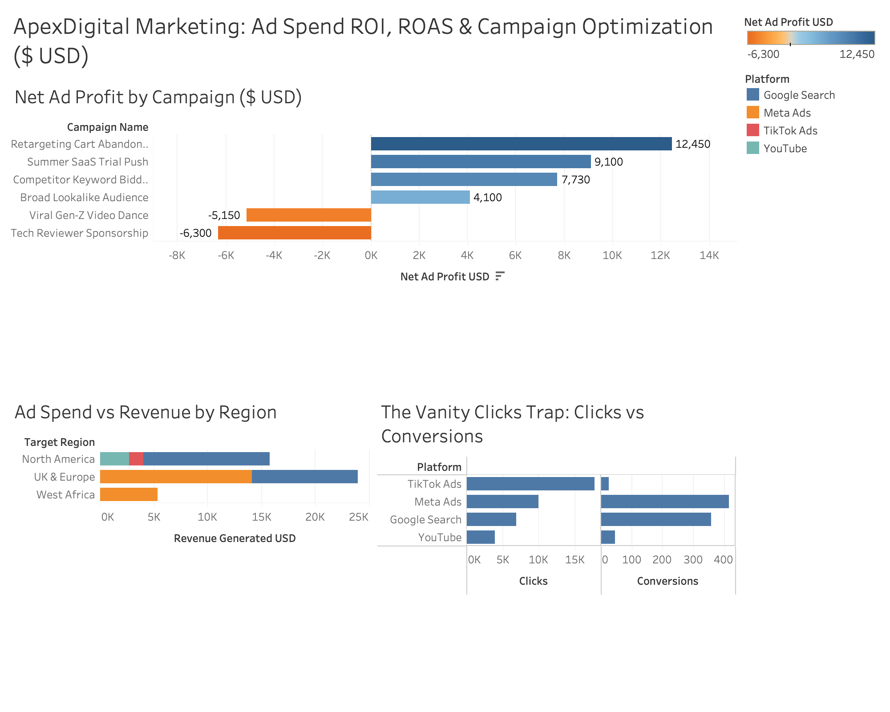

# 📈 ApexDigital Global Marketing: Ad Spend ROI, ROAS & CPA Optimization ($ USD)
**Tools Used:** MySQL (`JOIN`, `ROUND()`, ROAS & CPA Unit Economics, `CASE WHEN` Budget Rules) | Tableau (Executive Marketing ROI Dashboard)

## 📌 Executive Summary
ApexDigital manages **$22,950 USD** in monthly multi-channel digital ad spend across **Meta Ads (IG/FB), Google Search, TikTok Ads, and YouTube** targeting North America, UK & Europe, and West Africa. While top-line click traffic appeared strong, overall profitability was stagnating.

I analyzed campaign performance logs (`Ad_Performance_Logs` & `Campaigns_Info`) using MySQL and Tableau to audit **Return on Ad Spend (ROAS)**, **Cost Per Acquisition (CPA)**, and **Net Ad Profit**, exposing a massive "vanity clicks" cash burn.

---

## 📊 Executive Marketing ROI Dashboard (Tableau)

---

## 🔍 Key Marketing & Unit Economics Findings (via MySQL)

### 1. The "Vanity Clicks" Trap: Why High Traffic $\neq$ High Profit
- **TikTok Ads (`Viral Gen-Z Video Dance`):** Generated the highest traffic of any platform (**17,700 clicks**), misleading marketers into thinking the campaign was successful. However, it produced only **27 conversions**, burning **$6,500 USD** in ad spend to generate just **$1,350 USD** in revenue:
  - **ROAS:** `0.21x` *(80% loss on every dollar spent)*
  - **CPA:** `$240.74 USD` per customer
  - **Net Ad Loss:** **`-$5,150.00 USD`**
- **YouTube (`Tech Reviewer Sponsorship`):** Spent **$9,000 USD** for only 45 conversions (**`$200.00 CPA`**, **`0.30x ROAS`**), resulting in a **`-$6,300.00 USD` net loss**.

### 2. High-Performing Channels (`SCALE BUDGET` Winners)
- **Meta Ads (`Retargeting Cart Abandoners` & `Broad Lookalike`):**
  - Spent **$2,950 USD** total to generate **$19,500 USD** in revenue (**`6.61x` overall ROAS** and ultra-low **`$7.11 USD` CPA**).
  - *Retargeting Cart Abandoners (UK & Europe)* achieved our highest efficiency at **`8.55x ROAS`** (**+$12,450 USD net profit**).
- **Google Search (`Summer SaaS Trial Push` & `Competitor Keyword Bidding`):**
  - Spent **$4,650 USD** to generate **$21,480 USD** in revenue (**`4.62x ROAS`**, **`$12.99 USD CPA`**, **+$16,830 USD net profit**).

---

## 💡 Strategic Budget Reallocation Plan
1. **Immediate Pause on Cash-Burning Campaigns:** Pause `Viral Gen-Z Video Dance` (TikTok) and `Tech Reviewer Sponsorship` (YouTube) immediately, stopping **$15,500 USD** in unprofitable ad spend (**-$11,450 USD combined net loss**).
2. **Reallocate $10,000/Month to High-ROAS Channels:** Shift paused funds into **Meta Cart Abandonment Retargeting (`8.55x ROAS`)** and **Google Search High-Intent Keywords (`4.62x ROAS`)**, projected to generate an additional **+$45,000 to +$60,000 USD** in net monthly revenue.
